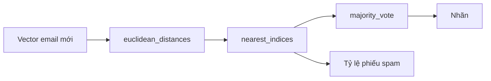

# KNN - K-Nearest Neighbors

## Purpose
KNN phân loại một email bằng nhãn của những email train gần nó nhất. Model không học trọng số. Fit chỉ lưu vector và nhãn. Predict mới tính khoảng cách. Đây là lazy learning: chi phí nằm lúc dự đoán, vì mỗi email mới phải so với toàn bộ train.

## Data used
Enron1 sau làm sạch: 4.888 email, train 3.911 (2.742 ham, 1.169 spam), test 977 (685 ham, 292 spam). Đặc trưng là TF-IDF tối đa 1.000 chiều, stop words tiếng Anh, fit trên train rồi transform test. Không dùng `label_num`, `source_row`, `word_count` hay `char_count`. File vào: `data/processed/train.csv`, `test.csv`, `X_train.npz`, `X_test.npz`, `vectorizer.json`. Cùng split và cùng vocabulary với Naive Bayes, xem [DATASET.md](../DATASET.md).

## Input / Output
Fit nhận `X_train` dạng `(3911, 1000)` và `y_train` 3.911 nhãn. Hàm đổi ma trận sparse thành dense rồi lưu. Không có hệ số hồi quy.

Predict nhận `X_test` dạng `(M, 1000)` và trả M nhãn. `predict_spam_score` trả tỷ lệ hàng xóm là spam. Với K=5, score chỉ nhận 0; 0,2; 0,4; 0,6; 0,8 hoặc 1.

`artifacts/knn.json` gồm K, ma trận train, nhãn và TF-IDF. Nạp file này là dự đoán được email mới, không fit lại. CSV đánh giá nằm ở `outputs/knn_predictions.csv`, `knn_metrics.csv`, `knn_confusion_matrix.csv`, `knn_roc_curve.csv`. Hình test: `outputs/figures/knn_test.png`.

## How it works
Các hàm toán ở `src/ml_scratch/formulas.py`. `KNNSpamClassifier` trong `classifiers.py` chỉ kiểm tra kích thước và gọi chúng.

1. `__init__(k=5)` giữ K. Lab khóa K=5 trước khi nhìn test.
2. `build_model` kiểm tra K là số nguyên dương và xóa trạng thái cũ.
3. `fit` kiểm tra K không lớn hơn số mẫu và số dòng khớp số nhãn, rồi lưu dense train cùng nhãn.
4. Email mới đi qua `clean_text` rồi `vectorizer.transform`. Vocabulary không học lại.
5. `euclidean_distances`: với từng dòng train z và email x, d(x, z) = sqrt(sum_j (x_j - z_j)^2).
6. `nearest_indices`: stable sort, lấy K chỉ số nhỏ nhất. Hai khoảng cách bằng nhau thì dòng train đứng trước được chọn.
7. `majority_vote`: đếm nhãn trong K hàng xóm, lấy nhãn nhiều phiếu nhất. Hòa phiếu thì lớp đứng trước theo thứ tự chữ cái, nên ham thắng spam.
8. Nhãn trả về là kết quả bỏ phiếu. Score spam = (số hàng xóm spam) / K. Score này là tỷ lệ phiếu, chưa phải xác suất đã calibration. ROC dùng chính tỷ lệ đó.

Dense train tốn RAM. Predict duyệt hết 3.911 vector cho mỗi email.

## Example
Ví dụ 2D này không phải embedding của TF-IDF. Nó chỉ để thấy từng phép trong `formulas.py`. Năm điểm train: (0, 0) ham, (1, 0) ham, (4, 4) spam, (5, 4) spam, (4, 5) spam. Query (0, 1), K=3.

Khoảng cách Euclid tới query:

| Điểm | Nhãn | Phép tính | d |
|---|---|---|---|
| 0 (0, 0) | ham | sqrt(0 + 1) | 1 |
| 1 (1, 0) | ham | sqrt(1 + 1) | sqrt(2) ≈ 1,414 |
| 2 (4, 4) | spam | sqrt(16 + 9) | 5 |
| 4 (4, 5) | spam | sqrt(16 + 16) | sqrt(32) ≈ 5,657 |
| 3 (5, 4) | spam | sqrt(25 + 9) | sqrt(34) ≈ 5,831 |

`nearest_indices` xếp 0, 1, 2, 4, 3. Ba hàng xóm đầu là ham, ham, spam. `majority_vote` ra ham. Score spam của ví dụ = 1/3. Trên model thật K=5 nên score là bội số của 1/5, không phải 1/3.

Bảng máy tính lại từ công thức: `outputs/reports/knn_toy_distances.csv`. Hình: `outputs/figures/knn_example.png`. Notebook `notebooks/04_KNN.ipynb` in bảng này trước khi fit corpus.

## Evaluation
Cùng test và cùng TF-IDF với Naive Bayes. Không thử nhiều K rồi chọn K theo test. Sau `fit`, pipeline lưu JSON, nạp lại và so `predict` trước với sau. `source_row` trong `knn_predictions.csv` trỏ về dòng raw. Cách chấm chung nằm ở [DESIGN.md](../DESIGN.md). Đối chiếu đã chạy: [VALIDATION.md](../VALIDATION.md).

## Metrics
Spam là lớp dương. Kết quả trên 977 email test:

| Chỉ số | Giá trị | Đọc trên ma trận |
|---|---|---|
| TN, FP, FN, TP | 665, 20, 15, 277 | 20 ham bị chặn, 15 spam bị sót |
| Accuracy | 96,42% | (665+277)/977 |
| Precision | 93,27% | 277/(277+20) |
| Recall / TPR | 94,86% | 277/(277+15) |
| F1 | 94,06% | trung bình điều hòa precision và recall |
| FPR | 2,92% | 20/(20+665) |
| ROC-AUC | 0,9882 | xếp hạng theo tỷ lệ phiếu spam |

So với Naive Bayes trên cùng test, KNN có ít FP hơn (20 so với 53) và ít FN hơn (15 so với 18). Số nếu chạy lại pipeline nằm ở `outputs/knn_metrics.csv`.

## Demo và giới hạn
Notebook 06 nạp JSON, làm sạch, transform, tính khoảng cách, bỏ phiếu, trả nhãn. Trong demo, thư họp ra ham với score 0; thư giải thưởng ra spam với score 1. Hai thư không nằm trong test.

Email không có từ nào trong vocabulary thành vector 0 và vẫn được gán theo hàng xóm của vector 0. Kết quả đó không đáng tin. Tỷ lệ phiếu không phải xác suất đã calibration. Một split Enron1 không đủ để kết luận KNN luôn tốt hơn Naive Bayes.
