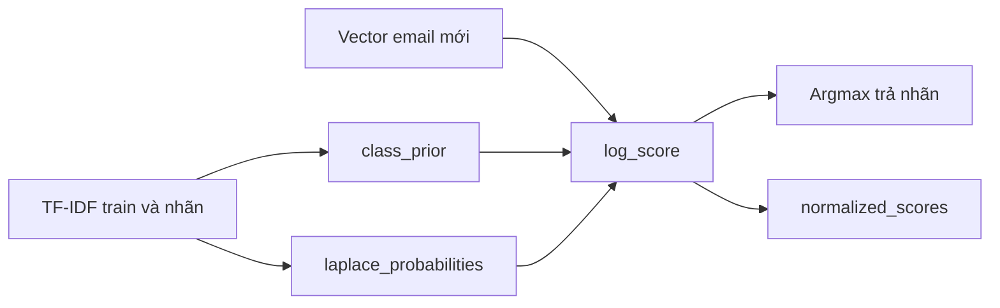

# Multinomial Naive Bayes

## Purpose
Multinomial Naive Bayes chấm mỗi lớp bằng prior của lớp và mức gắn của từng từ với lớp đó. Giả định các chiều độc lập khi đã biết lớp, nên điểm của một email là tổng đóng góp từng từ. Giả định này sai với ngôn ngữ thật, nhưng đủ để có một model nhỏ, học xong thì predict nhanh vì không lưu cả tập train.

## Data used
Cùng Enron1, cùng làm sạch, cùng split và cùng TF-IDF với KNN: train 3.911, test 977, tối đa 1.000 đặc trưng không âm. Fit vocabulary chỉ trên train. Không dùng `label_num` hay độ dài. Chi tiết cột và số dòng: [DATASET.md](../DATASET.md).

TF-IDF ở đây là trọng số thực, không phải số lần đếm nguyên. Công thức Laplace vẫn áp được vì trọng số không âm. Đọc `P(từ|lớp)` là trọng số đã làm trơn, không phải tần suất đếm từ thô.

## Input / Output
Fit nhận `X_train` `(3911, 1000)` và `y_train`. Học ba thứ: danh sách lớp, `prior[c]`, `word_probability[c]` dài 1.000.

Predict nhận `X_test` `(M, 1000)` và trả M nhãn, lớp có điểm log cao nhất. `predict_spam_score` đưa điểm log qua `normalized_scores`. Số này dương và tổng hai lớp bằng 1, nhưng chưa calibration: 0,9 không có nghĩa là 90% thư kiểu đó thật sự là spam.

`artifacts/naive_bayes.json` chứa alpha, classes, prior, word_probability, vocabulary và IDF. CSV: `outputs/naive_bayes_metrics.csv`, `naive_bayes_predictions.csv`, `naive_bayes_confusion_matrix.csv`, `naive_bayes_roc_curve.csv`. Hình: `outputs/figures/naive_bayes_test.png`.

## How it works
Công thức ở `formulas.py`. `NaiveBayesSpamClassifier` chọn dòng theo nhãn, cộng cột, rồi gọi công thức.

1. `__init__(alpha=1)` giữ alpha. Lab khóa alpha=1 trước khi nhìn test.
2. `build_model` kiểm tra alpha > 0 và xóa prior cùng bảng xác suất cũ.
3. `fit` lấy các lớp theo `np.unique` (thứ tự chữ cái: ham rồi spam). Với mỗi lớp c, đếm N_c và cộng TF-IDF theo cột thành S[c, j].
4. `class_prior`: P(c) = N_c / N.
5. `laplace_probabilities`: P(j|c) = (S[c, j] + alpha) / (sum_j S[c, j] + alpha * V). Alpha cộng vào tử và cộng alpha cho từng chiều ở mẫu, nên từ chưa thấy trong lớp vẫn có xác suất dương.
6. Email mới: `clean_text` rồi `transform` bằng vocabulary và IDF cũ. Từ lạ bị bỏ.
7. `log_score`: score(c) = log P(c) + sum_j x_j log P(j|c). Làm việc trên log để khỏi nhân nhiều số rất nhỏ.
8. Chọn lớp có điểm cao hơn. Hai điểm bằng nhau thì `argmax` lấy lớp đứng trước, tức ham. Vector toàn 0 không cộng gì từ các từ, nên chỉ còn log prior. Lớp đông hơn thắng.
9. `normalized_scores`: exp(score - max(score)) rồi chia tổng. Trừ max trước exp để khỏi tràn. Thành phần spam của vector này là spam score cho ROC.

## Example
Ví dụ đếm từ này không phải kết quả fit Enron. Hai ham `[2, 0]` và `[1, 0]`, hai spam `[0, 2]` và `[0, 1]`, alpha=1, query `[1, 0]`.

N = 4, mỗi lớp 2 email, nên `class_prior` cho P(ham) = P(spam) = 0,5.

Tổng theo lớp: ham `[3, 0]`, spam `[0, 3]`, V = 2.

Laplace ham: (3+1)/(3+0+2) = 0,8 và (0+1)/5 = 0,2. Spam ngược lại: 0,2 và 0,8.

Query `[1, 0]`:

- score(ham) = log(0,5) + 1·log(0,8) + 0·log(0,2) = log(0,4) ≈ -0,916
- score(spam) = log(0,5) + 1·log(0,2) + 0·log(0,8) = log(0,1) ≈ -2,303

Ham cao hơn, nhãn là ham. `normalized_scores` của hai điểm log này là `[0,8, 0,2]`. Spam score của ví dụ bằng 0,2. Trên corpus, score là số thực sau chuẩn hóa, không còn là các mức 0; 0,2; … của KNN.

Bảng máy tính: `outputs/reports/naive_bayes_toy_likelihood.csv` và `naive_bayes_toy_scores.csv`. Hình cột xác suất: `outputs/figures/naive_bayes_example.png`. Notebook `notebooks/05_Naive_Bayes.ipynb` áp các hàm này lên một email ham và một email spam trong test, sau khi đã fit 3.911 email.

## Evaluation
Cùng 977 email test với KNN, spam là lớp dương. Không chọn alpha hay ngưỡng bằng test. JSON được nạp lại và `predict` phải khớp bản vừa fit. Quy trình chung: [DESIGN.md](../DESIGN.md). Kiểm tra đã chạy: [VALIDATION.md](../VALIDATION.md).

## Metrics
Kết quả trên cùng test:

| Chỉ số | Giá trị | Đọc trên ma trận |
|---|---|---|
| TN, FP, FN, TP | 632, 53, 18, 274 | 53 ham bị chặn, 18 spam bị sót |
| Accuracy | 92,73% | (632+274)/977 |
| Precision | 83,79% | 274/(274+53) |
| Recall / TPR | 93,84% | 274/(274+18) |
| F1 | 88,53% | thấp hơn F1 của KNN trên split này |
| FPR | 7,74% | 53/(53+632) |
| ROC-AUC | 0,9811 | xếp hạng theo score đã chuẩn hóa |

Recall gần KNN nhưng FP cao hơn nhiều (53 so với 20). Model gọi spam rộng hơn. Muốn ít chặn nhầm ham thì nhìn precision và FPR. Số nếu chạy lại nằm ở `outputs/naive_bayes_metrics.csv`.

## Demo và giới hạn
Notebook 06 đi JSON → clean → transform → `log_score` từng lớp → argmax. Demo thư họp ra ham (score khoảng 0,11), thư giải thưởng ra spam (score khoảng 0,93). Hai thư không cộng vào accuracy.

Giả định độc lập làm các từ trong cùng một cụm bị tính như bằng chứng riêng. Email Enron là tiếng Anh lịch sử, chưa có tập ngoài. Score chuẩn hóa không phải xác suất đã calibration.
