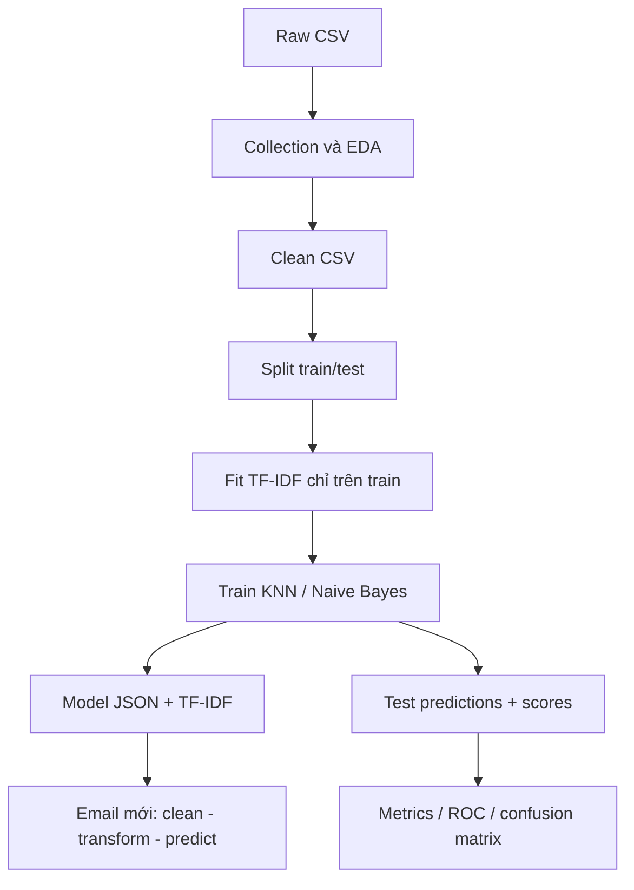
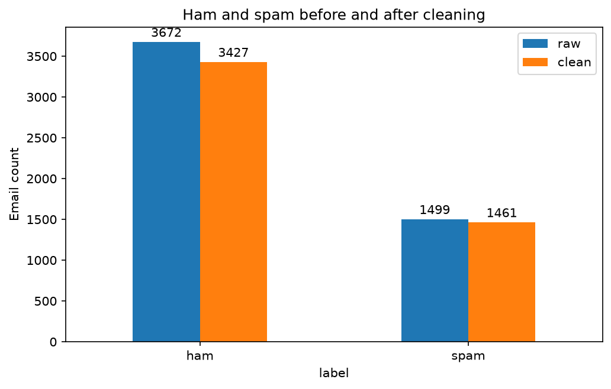
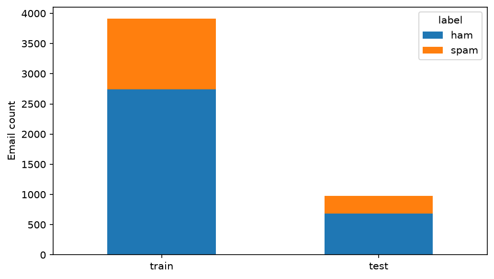
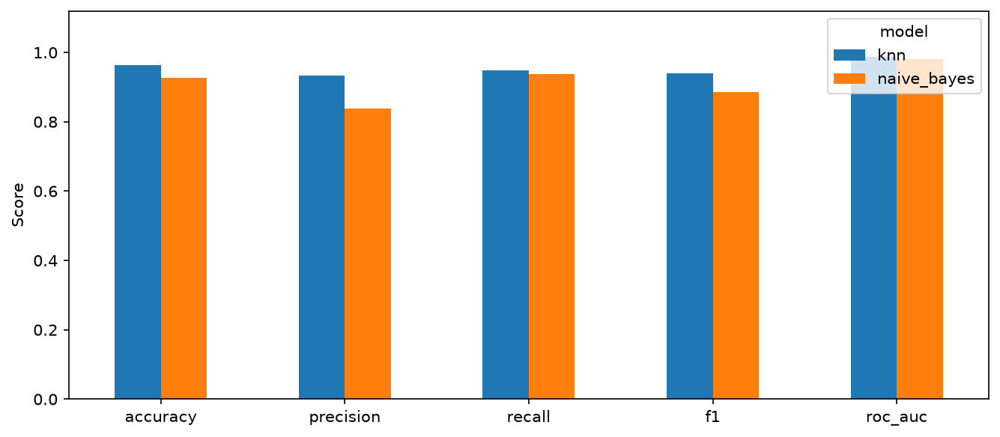
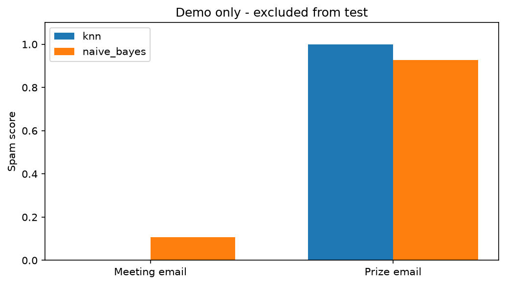

# Thiết kế và quy trình thực nghiệm

## Mục tiêu
Giải thích được EDA, feature engineering, công thức, train/test và đánh giá. Mỗi bước nêu một mục đích, ghi rõ file vào và file ra, rồi đọc số vừa tạo. Hai thuật toán đang chạy là KNN và Multinomial Naive Bayes, tự viết bằng NumPy. Công thức nằm trong `src/ml_scratch/formulas.py`; `classifiers.py` chỉ gọi các hàm đó khi fit và predict.

## Cấu trúc
- `data/raw/`: CSV gốc, không sửa.
- `data/train_data/`: notebook collection và EDA.
- `data/processed/`: dữ liệu sạch, split, sparse matrices, từ vựng và IDF.
- `src/ml_scratch/data.py`: collection, clean, split, TF-IDF và nạp đặc trưng.
- `src/ml_scratch/formulas.py`: từng công thức toán học, không I/O.
- `src/ml_scratch/classifiers.py`: điều phối fit/predict; gọi công thức.
- `src/ml_scratch/json_io.py`: lưu/nạp model và TF-IDF.
- `src/ml_scratch/evaluation.py`: đo chỉ số, vẽ biểu đồ, ví dụ tính tay và demo.
- `notebooks/`: giải thích, gọi từng bước, hiển thị kết quả và dự đoán email mới.
- `artifacts/`: JSON đã train. `outputs/`: kết quả đánh giá và hình.

## Step by step và đường truyền đầu ra
Mỗi notebook nêu một mục đích. File ghi ra là đầu vào của bước sau. Chạy lại một bước thì ghi đè đúng các file của bước đó.

| Bước | Notebook | Mục đích | Input | Output / bước tiếp theo |
|---|---|---|---|---|
| 01 | data/train_data/01_collection | Raw có bao nhiêu dòng, cột nào dùng được, có thiếu không? | data/raw/spam_ham_dataset.csv | outputs/reports/collection.json; raw vẫn để bước 02 đọc |
| 02 | data/train_data/02_EDA | Có trùng, lệch lớp, độ dài bất thường không? Làm sạch ra sao? | raw CSV | data/processed/clean_emails.csv; reports và hình EDA; chuyển 03 |
| 03 | notebooks/03_feature_engineering | Chia train/test và vector hóa thế nào mà không lộ test? | clean_emails.csv | train.csv, test.csv, X_train.npz, X_test.npz, vocabulary.csv, vectorizer.json; chuyển 04 và 05 |
| 04 | notebooks/04_KNN | KNN lưu gì khi fit và quyết định nhãn bằng công thức nào? | CSV split + NPZ + vectorizer.json | artifacts/knn.json; outputs/knn_metrics.csv, knn_predictions.csv, knn_confusion_matrix.csv, knn_roc_curve.csv |
| 05 | notebooks/05_Naive_Bayes | Prior và Laplace được tính thế nào, email mới lấy điểm ra sao? | cùng bộ file bước 03 | artifacts/naive_bayes.json và bốn CSV tiền tố naive_bayes_ |
| 06 | notebooks/06_evaluation_demo | Hai model khác nhau chỗ nào trên cùng test, email mới đi đường nào? | hai JSON và hai file predictions | outputs/reports/model_comparison.csv, demo.csv và biểu đồ |

`prepare()` trong bước 02 tự gọi `collection()`, nên notebook 02 vẫn làm sạch đúng nếu mở riêng. Notebook 01 vẫn cần chạy khi muốn đọc biên bản kiểm kê trước.

Schema các file giao nhau:

- `collection.json`: `source`, `rows`, `columns`, `missing`, `labels`. Đây là biên bản, không phải ma trận đặc trưng.
- `clean_emails.csv`: `source_row` (chỉ mục dòng raw), `text`, `label`, `clean_text`, `word_count`, `char_count`. 4.888 dòng sau khi bỏ 283 bản trùng chính xác.
- `train.csv` / `test.csv`: cùng các cột trên. Train 3.911 dòng (2.742 ham, 1.169 spam). Test 977 dòng (685 ham, 292 spam). Thứ tự dòng khớp `X_train.npz` / `X_test.npz`.
- `X_*.npz`: ma trận TF-IDF sparse, train `(3911, 1000)`, test `(977, 1000)`.
- `vocabulary.csv`: `feature_index`, `term`, `idf`. `vectorizer.json`: `vocabulary` và `idf` để transform email mới mà không fit lại.
- `artifacts/knn.json`: K, toàn bộ vector train, nhãn train, và TF-IDF. `artifacts/naive_bayes.json`: alpha, classes, prior, word_probability, vocabulary và IDF.
- `outputs/{model}_predictions.csv`: `source_row`, `label`, `prediction`, `spam_score`. Confusion matrix hàng là nhãn thật, cột là nhãn dự đoán, thứ tự ham rồi spam.

## EDA và Feature Engineering
EDA trả lời: dữ liệu có vấn đề gì và phân bố trông ra sao. Feature engineering trả lời: nội dung thư trở thành vector số nào để model đọc. Làm xong EDA chưa có model. Fit TF-IDF cũng chưa phải là huấn luyện KNN hay Naive Bayes.

Ví dụ trên lab này: EDA thấy ham chiếm khoảng 70% và độ dài có đuôi rất dài. Hai nhận xét đó không được đưa vào vector. Model chỉ nhận TF-IDF của `clean_text`. `word_count` và `char_count` dừng ở báo cáo EDA. Stop words không xóa lúc làm sạch. `TfidfVectorizer` tự viết bỏ chúng lúc tạo từ vựng, và từ vựng đó chỉ học trên train. IDF là `log((1+N)/(1+df))+1`, rồi nhân với số lần xuất hiện và chia chuẩn L2 từng dòng.

Cleaning trước khi tách tập: lowercase, bỏ HTML, thay ký tự ngoài `a-z`, `0-9` và khoảng trắng, gộp khoảng trắng, bỏ chuỗi rỗng, bỏ trùng đúng từng ký tự. Trùng khác nhãn thì dừng pipeline. Không cắt email dài. Chưa xử lý thư gần trùng hoặc cùng một chuỗi trao đổi.

## Thống kê và biểu đồ theo loại biến
Chọn thống kê theo kiểu dữ liệu. Trung bình của một chuỗi email không có nghĩa. Histogram của nhãn ham/spam cũng không có nghĩa.

| Loại biến | Mục đích | Thống kê | Biểu đồ | Vì sao không dùng cách khác |
|---|---|---|---|---|
| `label` | Lệch lớp không? | count và tỷ lệ | bar `data_labels.png`, có số trên cột | Nhãn là phân loại, không có median |
| `word_count`, `char_count` | Độ dài hai lớp có khác và có đuôi dài không? | mean, std, min, Q1, median, Q3, max | histogram và boxplot theo lớp trong `data_lengths.png` | Mean bị kéo bởi thư rất dài; median và quartile mô tả phần lớn thư |
| `text` | Có thiếu, rỗng, trùng không? Nội dung trông thế nào? | đếm thiếu/rỗng/trùng, vài dòng ví dụ | không vẽ trung bình chuỗi; độ dài là biến dẫn xuất | Chuỗi không cộng được |
| TF-IDF | Vector có bao nhiêu chiều, từ nào hiếm trên train? | shape, danh sách term, IDF | bar 15 IDF cao nhất, `feature_idf.png` | IDF cao nghĩa là từ hiếm trên train, không phải tầm quan trọng của KNN hay Naive Bayes |
| `source_row`, `label_num` | Dòng này ứng với dòng raw nào? | đối chiếu chỉ mục | không vẽ như biến liên tục | `label_num` chỉ là mã của `label`; đưa vào model là lặp nhãn |

Đọc số EDA của lần chạy hiện tại. Raw 5.171 email, không ô thiếu, không thư rỗng sau clean: 3.672 ham (71,01%) và 1.499 spam (28,99%). Bỏ 283 bản trùng chính xác, còn 4.888: 3.427 ham (70,11%) và 1.461 spam (29,89%). Lệch lớp gần như giữ nguyên, nên bước 03 phải stratify.

Độ dài lệch phải. Ham: median 87 từ nhưng mean khoảng 159, max 3.568 từ; median 449 ký tự, max 21.271. Spam: median 91 từ, mean khoảng 190, max 2.602 từ; median 511 ký tự, max 21.489. Histogram bị dồn về bên trái vì vài thư cực dài. Boxplot và bảng quartile trong `outputs/reports/numeric_summary.csv` cho thấy hai lớp chồng lên nhau. Vì vậy độ dài không được dùng làm đặc trưng.

## Quy trình đánh giá
Tám bước dưới đây khóa test. Mỗi bước chặn một kiểu nhìn thấy đáp án trước khi chấm.

1. Giữ raw. Loại missing, rỗng và trùng trước split, và kiểm tra trùng mà khác nhãn. Làm sạch sau split dễ để hai bản cùng nội dung rơi vào hai phía.
2. Chia 80/20, `seed=42`, stratify theo `label`. Train và test không có `clean_text` chung. Stratify giữ tỷ lệ ham khoảng 70% ở cả hai phía, gần với tỷ lệ sau làm sạch.
3. Fit vocabulary và IDF chỉ trên train. Test và email demo chỉ `transform`. Fit trên cả corpus sẽ để tần suất test lọt vào IDF.
4. K=5, alpha=1, `max_features=1000` cố định trước khi nhìn metric test. Không dò K, alpha hay ngưỡng trên test.
5. Spam là lớp dương. Cùng 977 email test, báo Accuracy, Precision, Recall, F1, TPR, FPR và ROC-AUC. Một chỉ số không đủ vì lớp lệch và chi phí FP khác FN.
6. Giữ `source_row` trong file dự đoán. So sánh hai model trên cùng chỉ mục và cùng nhãn. Hai email demo không nằm trong tập test và không cộng vào metric.
7. Lưu JSON rồi nạp lại; dự đoán sau nạp phải trùng dự đoán trước khi lưu. `artifacts/requirements-trained.txt` ghi phiên bản thư viện.
8. Nếu sau này có tuning: validation hoặc CV nằm trong train. Test chỉ chấm một lần cuối.

## Công thức đánh giá
Confusion matrix hàng thật, cột dự đoán, thứ tự ham/spam: `[[TN, FP], [FN, TP]]`.

- Accuracy = (TP+TN)/N: tỷ lệ đúng trên mọi email. Dễ nhìn cao khi ham đã chiếm khoảng 70%.
- Precision = TP/(TP+FP): trong những thư bị gọi là spam, bao nhiêu thư đúng.
- Recall = TP/(TP+FN) = TPR: trong spam thật, bắt được bao nhiêu.
- F1 = 2PR/(P+R) = 2TP/(2TP+FP+FN): trung bình điều hòa của precision và recall. Không cộng TN.
- FPR = FP/(FP+TN): trong ham thật, chặn nhầm bao nhiêu. FPR không phải 1 trừ precision.
- ROC vẽ TPR theo FPR khi đổi ngưỡng trên score. AUC là diện tích dưới đường đó. AUC 0,5 tương đương xếp hạng ngẫu nhiên. AUC không phải accuracy.

Đọc confusion matrix của lần chạy này, cùng 685 ham và 292 spam trong test.

KNN: TN 665, FP 20, FN 15, TP 277. Accuracy 96,42%, precision 93,27%, recall 94,86%, F1 94,06%, FPR 2,92%, AUC 0,9882. Hai mươi ham bị gọi là spam, mười lăm spam bị sót.

Naive Bayes: TN 632, FP 53, FN 18, TP 274. Accuracy 92,73%, precision 83,79%, recall 93,84%, F1 88,53%, FPR 7,74%, AUC 0,9811. Chặn nhầm nhiều ham hơn và sót thêm một ít spam so với KNN trên cùng split.

Không kết luận thuật toán nào luôn tốt hơn, vì mới có một lần chia và chưa đo thời gian, calibration hay tập ngoài Enron1.

## Visualization và phạm vi
Năm nhóm hình do code hiện tại ghi. Mỗi file phục vụ một mục đích.

- Data. `outputs/figures/data_labels.png`: số ham/spam trước và sau làm sạch, lệch lớp còn khoảng 70/30. `data_lengths.png`: histogram và boxplot của `word_count` và `char_count` theo lớp, đuôi dài và hai lớp chồng nhau. `feature_idf.png`: 15 từ có IDF cao nhất trên train, minh họa từ hiếm chứ không phải hệ số của model.
- Model / implementation. Sơ đồ ở trên và sơ đồ trong từng file thuật toán. Phép tính nằm ở `formulas.py`, luồng fit/predict nằm ở `classifiers.py`.
- Training / testing. `training_testing.png`: số ham/spam sau stratify, hai phía cùng kiểu lệch. `knn_test.png` và `naive_bayes_test.png`: confusion matrix cạnh ROC của đúng model đó trên 977 email test.
- Example. `knn_example.png` và `naive_bayes_example.png`: ví dụ tính tay vài điểm hoặc vài số đếm. Không phải hình chiếu của TF-IDF 1.000 chiều. Bảng số đi kèm ở `outputs/reports/knn_toy_distances.csv`, `naive_bayes_toy_likelihood.csv`, `naive_bayes_toy_scores.csv`.
- Demo. `demo.png` và `outputs/reports/demo.csv`: spam score của một thư họp và một thư giải thưởng. Hai thư này không tham gia test.

`evaluation_comparison.png` đặt cạnh nhau accuracy, precision, recall, F1 và AUC của hai model. Các file hình cũ khác trong `outputs/figures/` không thuộc pipeline hiện tại; tài liệu này không dùng chúng làm kết quả.

Chưa đo thời gian, chưa calibration, chưa external test. Một split không đủ để kết luận tổng quát.

## Mở các hình kết quả

Kiểm tra đã thực hiện: [VALIDATION.md](VALIDATION.md). Các hình `*_example` là ví dụ tính tay, không phải giảm chiều dữ liệu thật.
