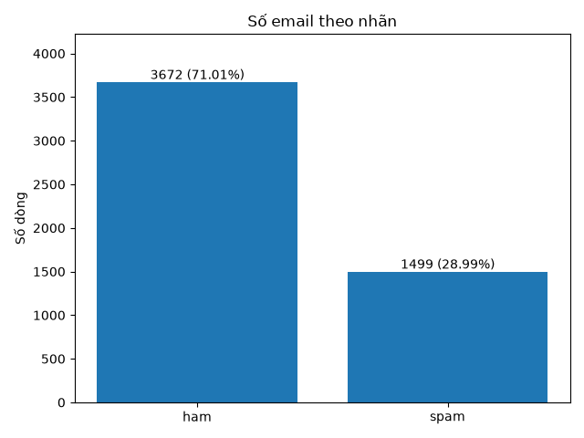
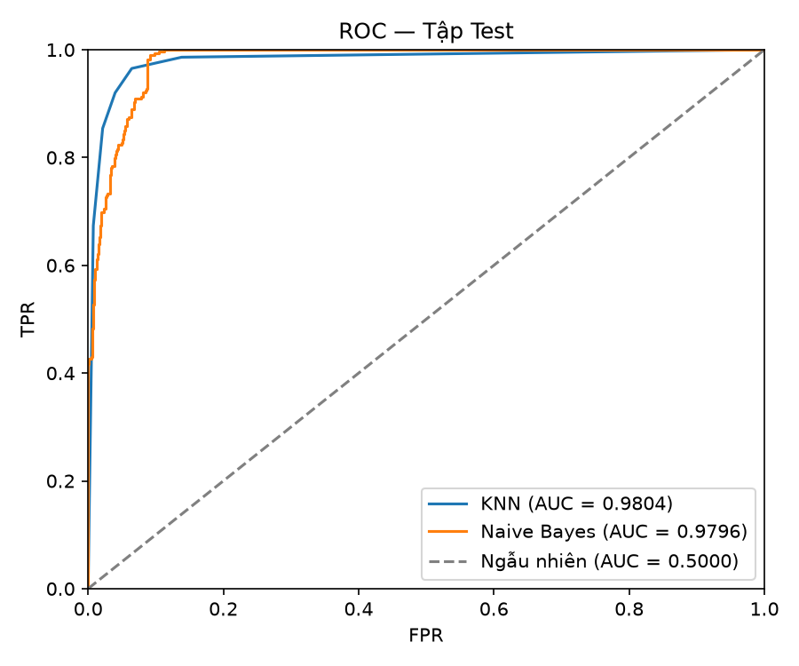
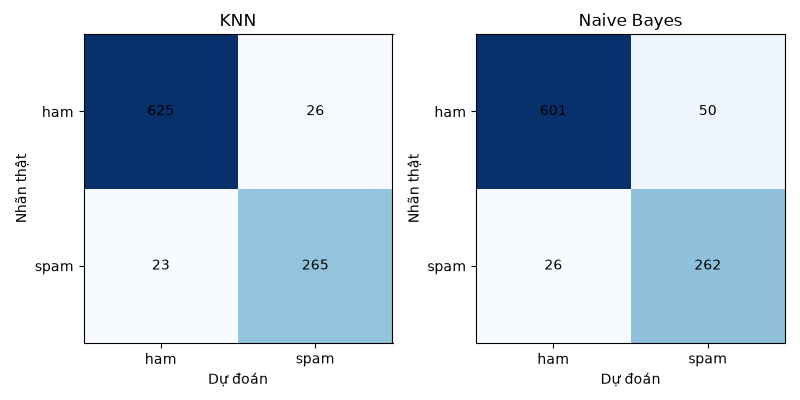

# Lab 01 — Báo cáo phân loại email spam

## 1. Mục tiêu

Phân loại email thành **Ham** (thư bình thường) hoặc **Spam** (thư rác). Dự án sử dụng TF-IDF để biểu diễn văn bản và so sánh hai mô hình **KNN** và **Multinomial Naive Bayes**.

## 2. Dữ liệu

- Tệp gốc: `data/raw/spam_ham_dataset.csv`.
- EDA ghi nhận **5.171 email** trong dữ liệu gốc.

| Nhãn | Số email | Tỷ lệ trên dữ liệu gốc |
|---|---:|---:|
| Ham | 3.672 | 71,01% |
| Spam | 1.499 | 28,99% |

Tỷ lệ được tính bằng số email của từng nhãn chia cho 5.171 rồi nhân 100. Dữ liệu gốc có nhiều thư Ham hơn thư Spam.



- Cột `text` chứa nội dung email; cột `label` chứa nhãn. `label_num` không được đưa vào đặc trưng.
- Pipeline chính chia theo tỷ lệ 80/20 trước khi làm sạch, với `seed=42` và stratify theo nhãn.

## 3. Quy trình chính

Pipeline chia Train/Test trước, rồi làm sạch từng tập.

```text
Dữ liệu gốc
    ↓
EDA — kiểm kê và khám phá phân bố nhãn
    ↓
Chia Train/Test 80/20 theo nhãn
    ↓
Làm sạch và loại trùng riêng từng tập
    ↓
Giữ nội dung trùng giữa hai tập ở Train, bỏ bản trùng khỏi Test
    ↓
TF-IDF: fit trên Train, transform Test
    ↓
Huấn luyện KNN và Naive Bayes trên Train
    ↓
Lưu model JSON và kiểm tra nạp lại
    ↓
Đánh giá trên Test
    ↓
Vẽ biểu đồ → xuất báo cáo → ghi nhật ký
```

- Làm sạch gồm chuyển chữ thường, bỏ thẻ HTML, xử lý ký tự và khoảng trắng; sau đó loại email rỗng, email trùng trong từng tập.
- TF-IDF dùng stop words tiếng Anh, tối đa **1.000 đặc trưng**; từ vựng và IDF chỉ được học trên Train.
- `src/eda.py` kiểm kê dữ liệu vào `reports/collection.json` và vẽ phân bố nhãn; bước này được gọi trong pipeline chính.

## 4. Thuật toán

Hai mô hình dùng cùng dữ liệu Train và cùng cách biểu diễn TF-IDF. Với mỗi class, `__init__()` nhận tham số, `build_model()` kiểm tra cấu hình, `fit()` chuẩn bị trạng thái từ Train và `predict()` gán nhãn cho email mới. Công thức KNN và Naive Bayes được triển khai trong `src/model.py` bằng NumPy/SciPy. TF-IDF và các chỉ số đánh giá dùng scikit-learn.

### 4.1. TF-IDF

Với từ `t` và email `d`, chương trình dùng số lần xuất hiện làm TF. IDF được tính từ tập Train:

$$
\operatorname{tfidf}(t,d)=\operatorname{tf}(t,d)\times\operatorname{idf}(t),\qquad
\operatorname{idf}(t)=\log\left(\frac{1+N}{1+df(t)}\right)+1
$$

- `N`: số email Train; `df(t)`: số email Train chứa từ `t`.
- Vector TF-IDF được chuẩn hóa bằng cách chia cho độ dài L2; vector toàn số 0 được giữ nguyên.
- TF-IDF dùng scikit-learn, fit trên Train và transform Test.

### 4.2. KNN

Khoảng cách Euclid giữa email cần dự đoán `x` và một email Train `z`:

$$
d(x,z)=\sqrt{\sum_{j=1}^{V}(x_j-z_j)^2}
$$

- `V` là số đặc trưng TF-IDF. Code tính bình phương khoảng cách `||x||² + ||z||² - 2(x · z)` để sắp thứ tự mà không cần lấy căn.
- Chọn `k=5` mẫu có khoảng cách nhỏ nhất. Điểm của lớp `c` là tỷ lệ láng giềng có nhãn `c`:

$$
\operatorname{score}(c\mid x)=\frac{1}{k}\sum_{i\in N_k(x)} \mathbf{1}(y_i=c),
\qquad \hat{y}=\arg\max_c \operatorname{score}(c\mid x)
$$

- Khi khoảng cách bằng nhau, ưu tiên mẫu có chỉ số Train nhỏ hơn; nếu hòa phiếu, ưu tiên lớp đứng trước theo thứ tự nhãn.

**Các bước tính trong mã**

1. `fit()` lưu vector TF-IDF và nhãn của 3.949 email Train, đồng thời tính sẵn bình phương độ dài của từng vector Train.
2. Với một email mới, `predict_proba()` tính bình phương khoảng cách Euclid từ vector của email đó tới mọi vector Train. Khoảng cách càng nhỏ thì hai vector càng gần nhau.
3. Sắp xếp khoảng cách tăng dần, lấy 5 láng giềng gần nhất và đếm phiếu Ham/Spam. Chia số phiếu cho 5 để lấy tỷ lệ của từng lớp.
4. `predict()` lấy lớp có nhiều phiếu nhất. Tỷ lệ phiếu Spam cũng là điểm dùng để vẽ ROC.

**Ví dụ minh họa.** Giả sử 5 láng giềng gần nhất theo thứ tự là Spam, Ham, Spam, Spam, Ham. Khi đó Spam có 3 phiếu, điểm là **0.6000**, còn Ham có 2 phiếu, điểm là **0.4000**. KNN dự đoán **Spam**. Đây là tỷ lệ phiếu trong nhóm láng giềng.

### 4.3. Multinomial Naive Bayes

Gọi `N_c` là số email Train thuộc lớp `c`; `N` là tổng số email Train; `S_cj` là tổng trọng số TF-IDF của đặc trưng `j` trên các email Train thuộc lớp `c`; `V` là số đặc trưng. Với `alpha = 1`:

$$
P(c)=\frac{N_c}{N},\qquad
P(j\mid c)=\frac{S_{cj}+\alpha}{\sum_{m=1}^{V}S_{cm}+\alpha V}
$$

Với email mới có vector TF-IDF `x`, tính điểm và chọn lớp có điểm cao nhất:

$$
\operatorname{score}(c\mid x)=\log P(c)+\sum_{j=1}^{V}x_j\log P(j\mid c),
\qquad \hat{y}=\arg\max_c\operatorname{score}(c\mid x)
$$

- Alpha làm trơn để các đặc trưng có xác suất dương. Trọng số đầu vào ở đây là TF-IDF không âm, không phải số đếm từ nguyên.
- Điểm ROC của Naive Bayes là `điểm Spam - điểm Ham`; đây là điểm xếp hạng, không phải xác suất.

**Các bước tính trong mã**

1. `fit()` đếm email theo lớp và chia cho tổng số email Train để lấy prior. Với Train hiện tại, prior Ham là 2.776/3.949 và prior Spam là 1.173/3.949.
2. Với từng lớp, cộng trọng số TF-IDF của từng đặc trưng trên các email thuộc lớp đó. Cộng `alpha=1` vào mỗi tổng, sau đó chia cho tổng trọng số đã làm trơn của cả lớp. Bước làm trơn giúp đặc trưng chưa xuất hiện trong một lớp vẫn có trọng số xác suất dương.
3. Lấy log của prior và xác suất đặc trưng. Với email mới, `predict_log_scores()` nhân TF-IDF của từng đặc trưng với log xác suất tương ứng rồi cộng vào log prior của lớp. Đặc trưng có TF-IDF bằng 0 đóng góp 0 vào điểm.
4. `predict()` chọn lớp có điểm log lớn hơn. Để vẽ ROC, dùng hiệu điểm Spam trừ điểm Ham.

**Ví dụ minh họa.** Giả sử email mới chỉ có một đặc trưng khác 0 với trọng số TF-IDF bằng 1. Nếu prior Ham/Spam lần lượt là 0.7000 và 0.3000, còn xác suất của đặc trưng trong hai lớp là 0.0200 và 0.1000, thì:

- Điểm Ham = log(0.7000) + log(0.0200) = **−4.2687**.
- Điểm Spam = log(0.3000) + log(0.1000) = **−3.5066**.
- Điểm Spam cao hơn nên mô hình dự đoán **Spam**. Các giá trị trên chỉ minh họa phép tính.

## 5. Đánh giá và kết quả

Spam là lớp dương: **TP** là Spam đoán đúng; **FN** là Spam bị bỏ sót; **FP** là Ham bị báo nhầm Spam; **TN** là Ham đoán đúng.

$$
Accuracy=\frac{TP+TN}{TP+TN+FP+FN},\quad
Precision=\frac{TP}{TP+FP},\quad
Recall=TPR=\frac{TP}{TP+FN}
$$

$$
F1=\frac{2\times Precision\times Recall}{Precision+Recall},\qquad
FPR=\frac{FP}{FP+TN}
$$

ROC là đường biểu diễn TPR theo FPR khi thay đổi ngưỡng điểm; AUC là diện tích dưới đường ROC. TPR/FPR trong bảng kết quả dùng nhãn dự đoán mặc định, còn ROC-AUC dùng các điểm xếp hạng qua nhiều ngưỡng.

### Kết quả trên tập Test

- Train: **3.949**; Test: **939** (651 Ham, 288 Spam).
- Bỏ 83 bản trùng khỏi Test (75 Ham, 8 Spam); Train đã có bản đại diện nên không thêm bản sao.
- Nội dung sạch trùng giữa hai tập: **0**. Tỷ lệ 80/20 là lúc chia ban đầu, trước xử lý.
- Số liệu từ `reports/metrics.csv`; Spam là lớp dương.

| Mô hình | Accuracy | Precision | Recall / TPR | F1 | FPR | AUC |
|---|---:|---:|---:|---:|---:|---:|
| KNN | 0.9478 | 0.9107 | 0.9201 | 0.9154 | 0.0399 | 0.9804 |
| Naive Bayes | 0.9191 | 0.8397 | 0.9097 | 0.8733 | 0.0768 | 0.9796 |

- KNN: TN=625, FP=26, FN=23, TP=265.
- Naive Bayes: TN=601, FP=50, FN=26, TP=262.
- ROC dùng điểm xếp hạng qua các ngưỡng; AUC cao không bảo đảm FPR thấp ở ngưỡng mặc định.





## 6. Đọc kết quả theo tình huống sử dụng

| Tình huống | Cách đọc kết quả trên 939 email Test | Lựa chọn |
|---|---|---|
| Tự động chuyển thư rác vào thư mục Spam | Ưu tiên giảm FP vì thư hợp lệ có thể bị người dùng bỏ qua. KNN báo nhầm **26/651** thư Ham (FPR **0.0399**). Naive Bayes báo nhầm **50/651** (FPR **0.0768**). | **KNN**, giảm 24 thư hợp lệ bị chuyển nhầm. |
| Cần phát hiện nhiều thư rác | Ưu tiên Recall và số FN. KNN bắt đúng **265/288** thư Spam (Recall **0.9201**), bỏ sót 23. Naive Bayes bắt đúng **262/288** (Recall **0.9097**), bỏ sót 26. | **KNN** ở thiết lập dự đoán hiện tại. |
| Đánh dấu thư đáng ngờ để người dùng kiểm tra | Precision cho biết danh sách cảnh báo đáng tin đến đâu. KNN có **265/291** cảnh báo đúng (Precision **0.9107**). Naive Bayes có **262/312** cảnh báo đúng (Precision **0.8397**). | **KNN** khi muốn giảm số cảnh báo nhầm người dùng phải xem. |

F1 tổng hợp Precision và Recall. Từ ma trận nhầm lẫn, KNN đạt **2 × 265 / (2 × 265 + 26 + 23) = 0.9154**. Naive Bayes đạt **2 × 262 / (2 × 262 + 50 + 26) = 0.8733**. Khoảng cách F1 trong lần chạy này đi cùng với mức giảm rõ hơn ở số thư Ham bị báo nhầm.

AUC của KNN (**0.9804**) và Naive Bayes (**0.9796**) gần nhau. AUC đo khả năng xếp hạng qua nhiều ngưỡng. Khi chọn mô hình để phân loại theo thiết lập hiện tại, số FP và FN cho biết trực tiếp người dùng sẽ gặp bao nhiêu lỗi mỗi loại trên Test.

Naive Bayes vẫn phát hiện đúng **262/288** thư rác. Mô hình là lựa chọn đáng xem xét nếu hệ thống ưu tiên tốc độ dự đoán hoặc kích thước mô hình. Naive Bayes tính điểm từ các trọng số đã học, còn KNN so sánh email mới với các vector Train. Lab hiện đo chất lượng phân loại, vì vậy cần đo thêm thời gian và bộ nhớ để chọn theo các tiêu chí vận hành đó.

## 7. Kết luận

Chọn **KNN với k = 5** cho bộ lọc thư rác trong cấu hình và tập Test hiện tại. KNN đưa nhầm ít hơn **24 thư hợp lệ** vào Spam và bỏ sót ít hơn **3 thư rác** so với Naive Bayes với alpha = 1. Kết quả này phù hợp với mục tiêu phát hiện thư rác đồng thời hạn chế làm người dùng bỏ lỡ thư hợp lệ.
