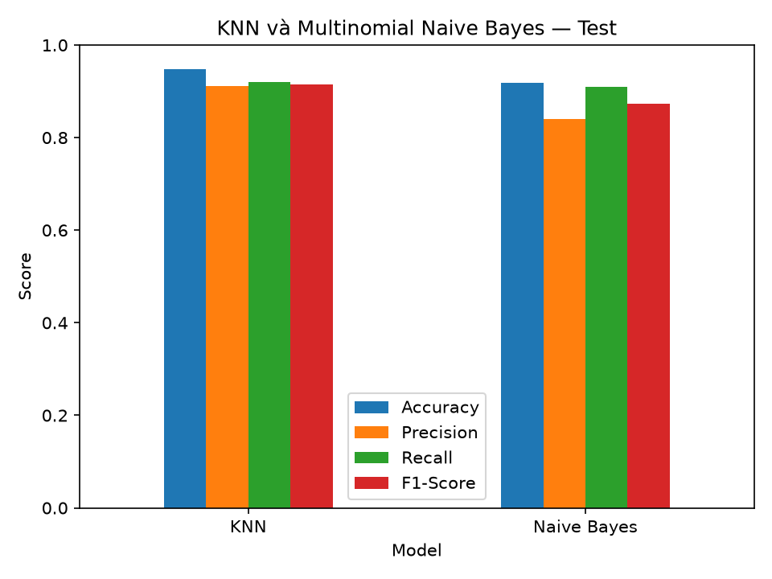
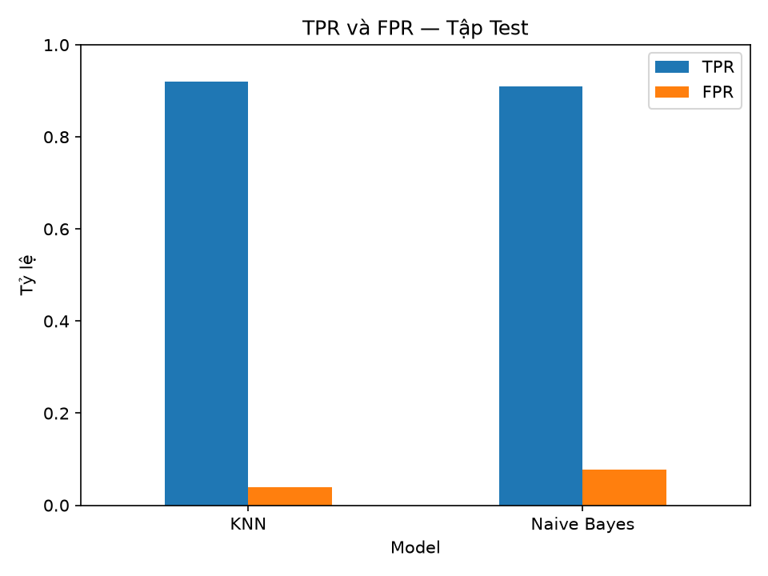
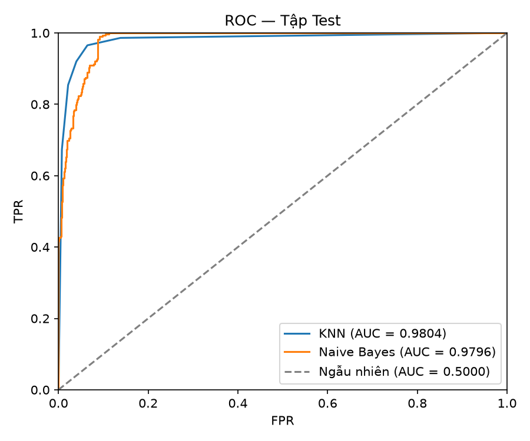

# Kết quả phân loại email

Nguồn: reports/metrics.csv; đánh giá tập Test. Không huấn luyện lại khi xuất báo cáo. Train: 3949; Test: 939; nội dung sạch trùng giữa hai tập: 0. Nội dung chung được giữ ở Train, bỏ bản trùng khỏi Test.

| Model | Feature Type | Accuracy | Precision | Recall | F1-Score | TPR | FPR | AUC | Ghi chú / Hyperparameters |
| --- | --- | --- | --- | --- | --- | --- | --- | --- | --- |
| KNN | TF-IDF | 0.9478 | 0.9107 | 0.9201 | 0.9154 | 0.9201 | 0.0399 | 0.9804 | k=5 |
| Naive Bayes | TF-IDF | 0.9191 | 0.8397 | 0.9097 | 0.8733 | 0.9097 | 0.0768 | 0.9796 | alpha=1 |

TPR bằng Recall; FPR là tỷ lệ email Ham bị báo nhầm là Spam. AUC đo khả năng xếp hạng trên các ngưỡng; xem xét dữ liệu trùng giữa Train và Test khi diễn giải kết quả.

